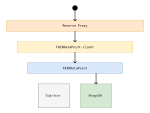

.. _components:

**********
Components
**********

The software stack for a typical FAIR Data Point deployment consists of five components, as depicted in the following image:

.. IMPORTANT::
   All FAIR Data Point components adhere to `Semantic Versioning <https://semver.org>`_, using the ``MAJOR.MINOR.PATCH`` format.
   The ``fdp`` and ``fdp-client`` components are released independently, so their version numbers do not match.
   For example, ``fdp`` |fdp_ver| is used with ``fdp-client`` |fdp_client_ver|.
   The combinations that are tested together can be found in the `FAIRDataTeam/compose`_ repository.

FAIRDataPoint
=============

The FAIRDataPoint component (``fdp``) is the core back-end component that handles all the business logic and operations on semantic data.
All functionality of this server-side application is exposed through a REST API.
Documentation for this API is generated by the ``fdp`` itself, and is available at the path ``/swagger-ui.html``.
A machine-readable OpenAPI description is available at ``/v3/api-docs``.

The ``fdp`` component can be deployed without a client (API only), but it is usually combined with the FAIRDataPoint-client_ component described below.
It is also possible to combine the ``fdp`` component with a custom client.

The ``fdp`` is a `Spring Boot <https://spring.io/projects/spring-boot>`_ application that runs on Java 25.
It is available as Docker image `fairdata/fairdatapoint`_.

FAIRDataPoint-client
====================

The FAIRDataPoint-client component (``fdp-client``) provides a user interface for humans, including a convenient admin interface.
The ``fdp-client`` is a client-side application that runs in a web browser and communicates with the ``fdp`` back-end using the API.

Note that the ``fdp-client`` component uses a built-in `nginx`_ instance for request routing based on content negotiation:

- Requests coming from a web browser (``Accept: text/html``) are assumed to be for human consumption, and are routed to the client-side application, which is served in the form of a *static* site.
- Requests with other content-types, such as ``text/turtle``, or those with an explicit format in the url query, such as ``?format=ttl``, are assumed to be for machine-readable data, and are routed directly to the API.
- Requests for the API documentation (``/swagger-ui.html``, ``/swagger-ui/``, ``/v3/api-docs``) are also routed to the API.

The same ``fdp-client`` image is used for a regular FDP and for an :ref:`FDP Index <fdp-index>`.
The client detects the index mode from the ``fdp`` configuration.
Since version 1.18.0 of the client, the separate ``fairdata/fairdatapoint-index-client`` image is no longer needed.

The FAIRDataPoint-client component is available as Docker image `fairdata/fairdatapoint-client`_.

.. NOTE::
   A new user interface, `FAIRDataPoint-UI`_ (Docker image ``fairdata/fairdatapoint-ui``), is under development and will eventually replace the ``fdp-client``.
   At the time of writing, FAIRDataPoint-UI can be used to view an FDP, but not yet to edit it, and it is not production-ready.
   The development stacks in the `FAIRDataTeam/compose`_ repository already include it, next to the ``fdp-client``.

Third-party components
======================

The FAIR Data Point relies on several third-party components

MongoDB
-------

The FAIRDataPoint component depends on a `MongoDB <https://www.mongodb.com>`__ database to store application data, i.e. data required for the application to function properly, such as settings, user accounts, roles, metadata schemas, and so on.

This component is available as Docker image `mongo`_.
The compose files in the `FAIRDataTeam/compose`_ repository currently use version |mongo_ver|.

Triple Store
------------

The FAIRDataPoint component depends on a triple store to store its semantic data.
A variety of triple stores are supported, as described in :ref:`Triple Stores configuration <triple-stores>`.
If no external triple store is configured, the FDP will fall back on an in-memory triple store.

For example, GraphDB is available as Docker image `ontotext/graphdb`_.

Reverse Proxy
-------------

In a production deployment, there is usually a reverse proxy that handles HTTPS certificates (SSL/TLS), so the connection to the FAIR Data Point is secured.
See :ref:`production deployment <production-deployment>` to learn how to configure one.

For example, nginx is available as Docker image `nginx <nginx-image_>`_.

.. _fairdata/fairdatapoint: https://hub.docker.com/r/fairdata/fairdatapoint
.. _fairdata/fairdatapoint-client: https://hub.docker.com/r/fairdata/fairdatapoint-client
.. _FAIRDataPoint-UI: https://github.com/FAIRDataTeam/FAIRDataPoint-UI
.. _FAIRDataTeam/compose: https://github.com/FAIRDataTeam/compose
.. _mongo: https://hub.docker.com/_/mongo
.. _nginx: https://nginx.org/index.html
.. _nginx-image: https://hub.docker.com/_/nginx
.. _ontotext/graphdb: https://hub.docker.com/r/ontotext/graphdb/
